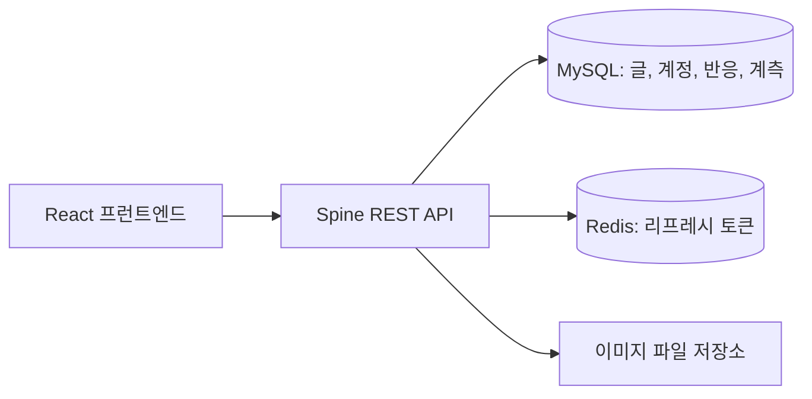

<div align="center">
  <h1>Tech Blog Spine</h1>
  <p><strong>글과 독자, 운영 데이터를 연결하는 기술 블로그 API</strong></p>
  <p>NARUBROWN 기술 블로그를 위한 Go와 Spine 기반 REST API입니다.</p>
  <p>
    
    <a href="https://github.com/NARUBROWN/spine"></a>
    
    
    <a href="LICENSE"></a>
  </p>
  <p>
    <a href="https://na2ru2.me"><strong>블로그 방문하기</strong></a>
    &nbsp; / &nbsp;
    <a href="https://github.com/NARUBROWN/tech-blog-react">프런트엔드 저장소</a>
    &nbsp; / &nbsp;
    <a href="#빠른-시작">빠른 시작</a>
    &nbsp; / &nbsp;
    <a href="docs/operations.md">운영 가이드</a>
  </p>
</div>

---

## 소개

게시글과 계정 관리부터 익명 댓글, 좋아요, 관리자 통계까지 기술 블로그 운영에 필요한 API를 제공합니다. 기존 Spring Boot 백엔드의 HTTP 계약과 도메인 동작을 Go 기반 [Spine](https://github.com/NARUBROWN/spine)으로 옮겼습니다.

[tech-blog-react](https://github.com/NARUBROWN/tech-blog-react)가 화면을 담당하며, 이 저장소는 인증, 권한 확인, 데이터 저장, 이미지 제공과 계측을 담당합니다. 프로젝트 골격과 초기 리소스 모듈은 Spine CLI로 생성했습니다.

## 주요 기능

| 영역 | 제공하는 기능 |
| --- | --- |
| 게시글 | CRUD, 슬러그 조회, 카테고리와 태그, 검색과 페이지네이션, SEO 필드, 조회수 |
| 인증과 권한 | HMAC-SHA256 JWT, HttpOnly 쿠키, Redis 리프레시 토큰, 사용자와 작성자 및 관리자 권한 |
| 독자 반응 | 비밀번호를 확인하는 익명 댓글, 방문자 쿠키 기반 좋아요, 중복 반응 제약과 요청량 제한 |
| 이미지 | PNG, JPEG, WebP 형식과 20MB 제한 검사, 파일 저장과 조회 |
| 방문과 행동 분석 | 익명 방문자, 세션, 활성 체류시간, 스크롤과 유입 경로, 공개 페이지의 클릭과 문장 선택 |
| 성능 분석 | 서버 처리와 API 왕복, 화면 콘텐츠 준비, FCP/LCP/INP, p50/p95/p99 통계 |
| 실행 계약 | Spine 정적 계약 검사, OpenAPI 내보내기, 계약 스냅샷과 의미 변경 비교 |
| 배포 | Docker Compose 로컬 구성, GitHub Actions 검증, OCI 배포와 Nginx 전환 |

## 구성 한눈에 보기



| 구성 요소 | 역할 |
| --- | --- |
| Go 1.25.5 이상 / Spine 0.5.1 | HTTP 라우팅, 의존성 구성, 인터셉터, 애플리케이션 부팅 |
| MySQL | 도메인 데이터와 트랜잭션, 댓글과 반응, 방문과 성능 표본 저장 |
| Redis | 리프레시 토큰 저장과 확인 |
| Docker Compose | MySQL 8.4, Redis 7.4, API를 함께 실행 |
| GitHub Actions | 코드 검사, MySQL과 Redis 통합 검증, Linux 빌드와 OCI 배포 |

## 빠른 시작

### Docker Compose로 실행

Docker와 Docker Compose를 준비한 뒤 아래 순서로 실행합니다. Go를 따로 설치할 필요는 없습니다.

```bash
git clone https://github.com/NARUBROWN/tech-blog-spine.git
cd tech-blog-spine
cp .env.example .env
```

`.env`에서 `MYSQL_PASSWORD`, `MYSQL_ROOT_PASSWORD`, `JWT_SECRET`을 자신의 값으로 변경하세요. `JWT_SECRET`은 32바이트 이상의 무작위 값이어야 합니다. 로컬 HTTP에서 로그인과 방문자 쿠키를 사용하려면 `COOKIE_SECURE=false`로 설정합니다.

```bash
docker compose up -d --build

# 서버 상태와 DB를 사용하는 게시글 목록 확인
curl -fsS http://localhost:8080/health
curl -fsS 'http://localhost:8080/api/v1/post?page=0&size=5'
```

API 기본 주소는 `http://localhost:8080/api/v1`입니다. 새 MySQL 볼륨을 처음 만들 때 [migrations/](migrations/)의 SQL이 실행됩니다. 기존 볼륨에는 초기화 SQL이 다시 실행되지 않습니다.

```bash
docker compose logs -f api
docker compose down
```

이미지와 DB는 이름 있는 볼륨에 보관합니다. 프런트엔드는 별도 터미널에서 [실행 가이드](https://github.com/NARUBROWN/tech-blog-react#로컬-실행)에 따라 시작하세요.

<details>
<summary><strong>Go로 직접 실행하기</strong></summary>

Go 1.25.5 이상, MySQL 8, Redis 7 이상이 필요합니다. 먼저 MySQL 데이터베이스와 사용자를 준비하고 `.env`의 연결 정보를 맞춥니다. **새 로컬 데이터베이스에만** 아래 스키마 초기화를 실행하세요. 기존 데이터 이전은 [운영 가이드](docs/operations.md)를 따릅니다.

```bash
set -a
source .env
set +a

for migration in migrations/[0-9]*.sql; do
  MYSQL_PWD="$MYSQL_PASSWORD" mysql \
    -h "$MYSQL_HOST" -P "$MYSQL_PORT" \
    -u "$MYSQL_USER" "$MYSQL_DATABASE" < "$migration"
done

go run .
```

[Spine CLI](https://github.com/NARUBROWN/spine-cli)를 설치했다면 `go run .` 대신 `spine run`을 사용할 수 있습니다.

</details>

## 환경변수

전체 예시는 [.env.example](.env.example), 실제 기본값과 검증은 [internal/config/config.go](internal/config/config.go)에서 확인할 수 있습니다. `.env`는 Git에 포함하지 않습니다.

| 이름 | 기본값 | 설명 |
| --- | --- | --- |
| `MYSQL_DATABASE` | 필수 | 데이터베이스 이름 |
| `MYSQL_USER` | 필수 | MySQL 사용자 |
| `MYSQL_PASSWORD` | 필수 | MySQL 비밀번호 |
| `JWT_SECRET` | 필수 | 32바이트 이상의 JWT 서명 키 |
| `MYSQL_HOST` / `MYSQL_PORT` | `127.0.0.1` / `3306` | MySQL 연결 주소 |
| `MYSQL_ROOT_PASSWORD` | Compose에서 설정 | 로컬 MySQL 초기화용 root 비밀번호 |
| `REDIS_ADDR` | `127.0.0.1:6379` | Redis 연결 주소 |
| `REDIS_PASSWORD` / `REDIS_DB` | 빈 값 / `0` | Redis 인증과 DB 번호 |
| `REDIS_TLS` | `false` | Redis TLS 연결 |
| `IMAGE_UPLOAD_DIR` | `./images` | 이미지 파일 저장 경로 |
| `ALLOWED_ORIGINS` | `http://localhost:5173` | 쉼표로 구분한 CORS 허용 origin |
| `COOKIE_SECURE` | `true` | HTTPS 쿠키 사용. 로컬 HTTP에서만 `false` |
| `SPINE_PORT` | `8080` | HTTP 서버 포트 |

앱은 `.env`를 자동으로 읽지 않습니다. Compose는 파일의 값을 전달하고, 직접 실행할 때는 위 예시처럼 셸 환경변수로 불러옵니다. HTTPS 운영 환경에서는 `COOKIE_SECURE=true`를 유지하세요.

## API 안내

아래 경로에는 `/api/v1` 접두사가 붙습니다. `/health`는 서버 루트에 있습니다. `page`는 0부터 시작합니다.

| 영역 | 대표 요청 | 접근 조건 |
| --- | --- | --- |
| 인증 | `POST /auth/login`, `POST /auth/logout` | 공개 |
| 회원가입 | `POST /user/normal-signup` | 공개 |
| 권한 계정 생성 | `POST /user/author-signup`, `POST /user/admin-signup` | 관리자 |
| 프로필 | `PATCH /user/{id}` | 본인 또는 관리자 |
| 글 조회와 검색 | `GET /post`, `GET /post/slug/{slug}`, `GET /post/id/{id}`, `GET /post/search/recent` | 공개 |
| 글 작성 | `POST /post?categoryId={id}` | 작성자 또는 관리자 |
| 글 수정과 삭제 | `PATCH /post?postId={id}&categoryId={id}`, `DELETE /post/{id}` | 해당 글 작성자 또는 관리자 |
| 조회수 | `POST /post/view-count/{id}` | 공개 |
| 카테고리 | `GET /category/list`, `POST /category?name={name}` | 조회 공개, 생성 관리자 |
| 이미지 | `POST /image`, `GET /image/{uuid}` | 공개, 업로드 필드 `file` |
| 댓글 | `GET/POST /comments/post/{id}`, `PATCH/DELETE /comments/{id}` | 공개, 수정과 삭제는 비밀번호 확인. 관리자 삭제 가능 |
| 좋아요 | `GET /like/{id}/state`, `POST/DELETE /like/{id}` | 상태 조회로 방문자 쿠키 발급 후 반응 가능 |
| 좋아요 계정 목록 | `GET /like/{id}` | 공개 |
| 방문과 행동 수집 | `POST /analytics/visits`, `POST /analytics/events` | 방문자 쿠키 등 서버 검증 적용 |
| 공개 관심 수 | `GET /analytics/interest` | 공개 |
| 관리자 통계 | `GET /admin/analytics`, `GET /admin/analytics/events`, `GET /admin/analytics/performance` | 관리자 |

작성자와 관리자 계정은 기존 관리자만 생성할 수 있습니다. 새 로컬 DB에는 관리자 계정이 자동으로 생성되지 않으며 일반 회원가입으로 작성 권한을 얻을 수 없습니다. 관리자 API는 DB의 역할을 다시 확인합니다.

기본 HTTP 계약은 [OpenAPI 문서](docs/openapi.json), 최신 등록 경로는 [src/](src/)에서 확인할 수 있습니다. 변경 후에는 Spine CLI로 OpenAPI를 다시 내보낼 수 있습니다.

## 실행 계약과 검증

[Spine CLI](https://github.com/NARUBROWN/spine-cli)를 설치한 환경에서 실행합니다.

```bash
spine schema --json
spine capabilities --json
spine context --root . --json
spine contract check --json
spine contract diff --json
spine verify --json
```

`spine verify`는 정적 계약, 포맷, `go vet`, `go test`를 확인합니다. 실제 MySQL과 Redis 연결, HTTP 요청과 배포 환경은 별도 통합 검증 범위입니다. [CI 워크플로](.github/workflows/ci.yml)는 MySQL과 Redis를 준비해 [통합 검증 스크립트](scripts/integration.go)도 실행합니다. 이 스크립트는 이름이 `_test`로 끝나는 격리 DB만 허용합니다.

<details>
<summary><strong>OpenAPI 내보내기</strong></summary>

```bash
spine contract export --format openapi --output docs/openapi.json --force
```

OpenAPI는 정적 소스 분석 결과입니다. 실제 응답 상태와 인증 조건, 운영 환경의 동작은 구현과 통합 검증 결과를 함께 확인하세요.

</details>

## 프로젝트 구조

```text
internal/
├── application/      # Spine 의존성 구성, 인터셉터, 부팅 옵션
├── blog/             # 블로그 유스케이스와 이미지 저장
├── config/           # 환경변수와 설정 검증
├── model/            # 도메인 모델과 API DTO
├── security/         # JWT, Redis 토큰 저장, 인증 인터셉터
├── store/            # MySQL 저장소와 트랜잭션
└── telemetry/        # 서버 처리 시간 계측
src/                  # 기능별 HTTP 라우트, 컨트롤러와 모듈
cmd/migrate/          # 기존 스키마와 추가 테이블 준비
migrations/           # 새 DB 스키마와 기능별 추가 SQL
docs/                 # OpenAPI, 운영과 이전 기록
deploy/               # OCI 배포 이미지와 전환 스크립트
scripts/              # MySQL과 Redis 통합 검증
compose.yaml          # 로컬 API, MySQL, Redis 구성
spine.contract.json   # 정적 실행 계약 스냅샷
```

## 배포와 운영 문서

`main`에 push하면 GitHub Actions가 검사와 통합 테스트, Linux amd64 빌드를 거쳐 OCI 배포를 수행합니다. PR에서는 검증만 실행합니다. 운영 환경변수는 서버에 보관하고, 배포 스크립트는 새 컨테이너의 상태와 DB 조회를 확인한 뒤 Nginx를 전환합니다.

- [운영과 데이터 이전 가이드](docs/operations.md): 기존 Spring 데이터 전환, 이미지 보존, 배포와 롤백, 댓글과 계측의 세부 정책
- [마이그레이션 점검 기록](docs/migration-audit-2026-10-31.md): 전환 당시 확인한 변경과 검증 범위
- [배포 워크플로](.github/workflows/ci.yml) / [배포 스크립트](deploy/deploy.sh)

## 라이선스

[CC BY-NC 4.0](LICENSE)을 따릅니다. 저작자 표시와 비영리 이용 조건을 확인해 주세요.
